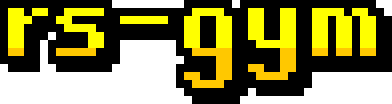
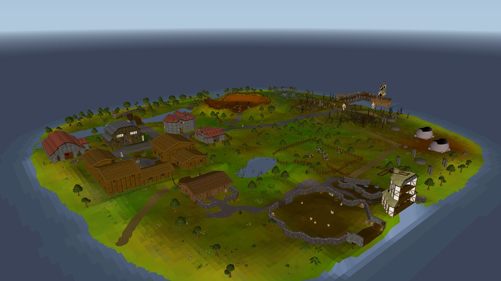
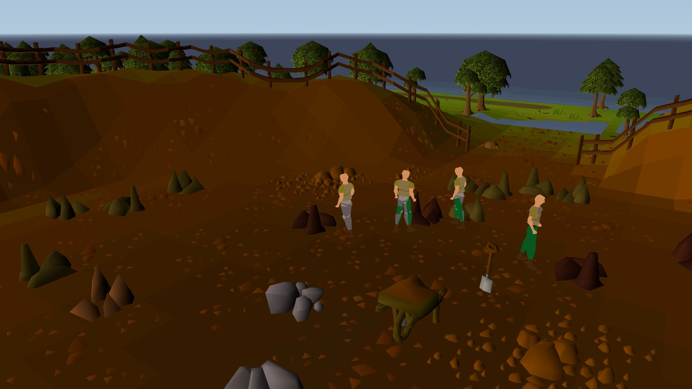

<p align="center">
  
</p>

<p align="center">A miniature Old School RuneScape for reinforcement learning.</p>



## What it is

rs-gym is a small, complete OSRS-style world built from OSRS (b237) cache content. A headless C engine
runs the game, agents play it through a C API or PufferLib 5.0, and an OSRS-style client lets you
play it yourself or watch recorded episodes.

## Purpose

To give RL agents a long-horizon game with the depth of OSRS at a size they can actually master.
Agents start at level 1 with a starter kit, train skills, make their own supplies, earn money, trade
with each other and work up to a boss, alone or as a team. Runs are deterministic for a seed and
action sequence.



## Content

The v1 benchmark mode is `compact_osrs_v1`:

- **World:** one island with a village, bank, shops, farm, quarry and pier, above one connected
  dungeon of sewers, a moss cave and gated rooms.
- **Players:** 1 to 8 in a shared world.
- **Skills:** Attack, Strength, Defence, Hitpoints, Ranged, Magic, Prayer, Mining, Smithing,
  Woodcutting, Fletching, Fishing, Cooking, Crafting and Runecraft, capped at level 40.
- **Enemies:** chickens, cows, giant rats, goblins, skeletons, dark wizards and hill giants.
- **Boss:** Scurrius, shared and scaled to the group, with melee, ranged and magic attacks, falling
  bricks, rat summons and feeding phases. Its drops make bone weapons.
- **Economy:** closed production chains, fixed-price shops, a bank and player trading.

## Usage

You need Python 3.11+ with Pillow and NumPy, CMake 3.20+, a C11 compiler, zlib and OpenGL.

You also need a local `data/` directory holding the OSRS b237 cache and the exported definitions,
models and UI art. It isn't in this repo because it's Jagex content.

Run everything from the repo root:

```bash
# Build the code, the mode's data and run the tests
cmake -S . -B build/cmake -DCMAKE_BUILD_TYPE=Release
cmake --build build/cmake --parallel
python3 tools/build_mode.py
ctest --test-dir build/cmake --output-on-failure

# Play it
./build/cmake/rc-viewer --mode compact_osrs_v1

# Record four random agents, then watch the replay
./build/cmake/rs-gym-rollout --mode compact_osrs_v1 --agents 4 --ticks 3000 --record build/replays/compact.rgc
./build/cmake/rc-viewer --replay build/replays/compact.rgc

# Hook into a PufferLib 5.0 checkout
tools/puffer_overlay.sh /path/to/PufferLib
```

The C API, observations, actions and task profiles are in [rc-env/README.md](rc-env/README.md).
Viewer controls are in [rc-viewer/README.md](rc-viewer/README.md).

## Version

v1: mode `compact_osrs_v1` version 1, OSRS revision b237, RL schema compact-v2.

The full design is in [SPEC.md](SPEC.md), open work in [TODO.md](TODO.md) and the history in
[CHANGELOG.md](CHANGELOG.md).

## Legal

Old School RuneScape content, names and assets belong to Jagex Ltd. rs-gym is not affiliated with
Jagex. Keep `data/` private.
